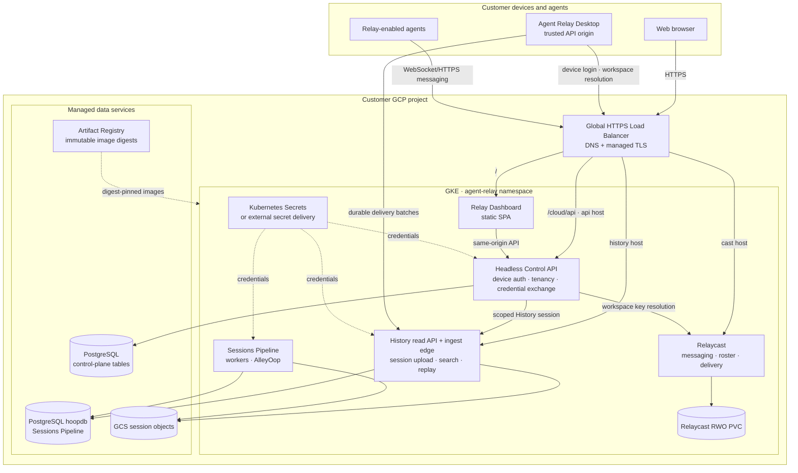

# Self-hosted Agent Relay architecture

## Trust and data boundaries

- The Desktop persists one public HTTPS control-plane origin. It does not store
  a deployment-wide workspace key in `deployment.json`.
- The control API binds users to an organization and workspace, then returns
  scoped Relaycast and History credentials. History is native: relay-control's
  native backend, the Sessions read API and the ingest edge share the history
  host and read and write the Sessions Pipeline `hoopdb` and GCS objects. No
  RelayAuth is needed.
- Public traffic enters through one GKE Ingress. Services remain `ClusterIP`;
  sensitive Relaycast administration paths are denied at the edge.
- Runtime and migration-owner database credentials are separate.
- Relaycast and the proof profile are single-writer components.
  This architecture is `portable-single`, not HA.

## Included and excluded

Included: messaging, agent roster and replies, session upload, durable retry,
search, replay, Dashboard, device login, and custom Desktop origin.

Excluded: Relayflows, Relayfile, billing, provider integrations, hosted fleet,
and hosted MCP.
