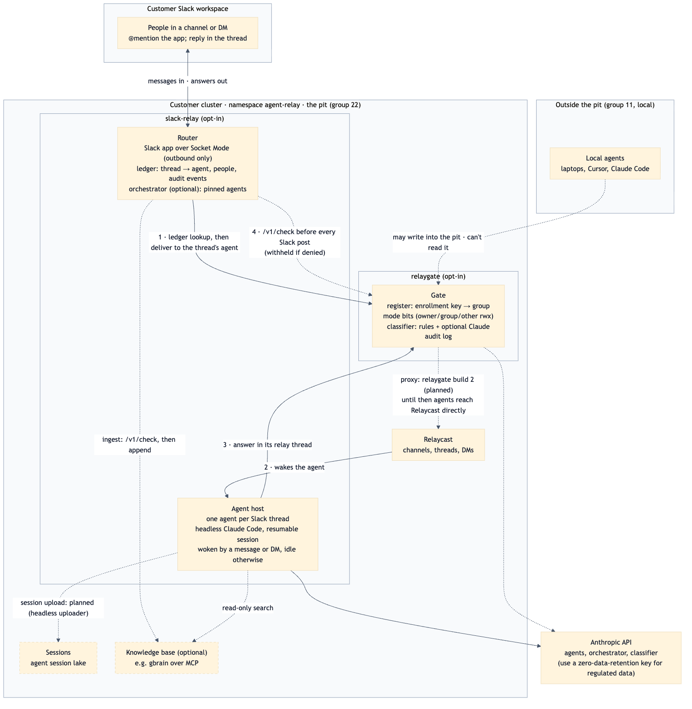

# relaygate (optional governance gate)

[relaygate](https://github.com/AgentWorkforce/relaygate) sits between agents and
Relaycast/Sessions. Agents register into a **group** with an enrollment key;
every request is checked against owner/group/other **mode bits**; writes that
cross a group boundary or leave through an external stream (a Slack thread, a
knowledge base) go through a **classifier** (rules, plus an optional Claude
model). Denials never reach upstream. It is opt-in: `components.relaygate` in
the umbrella, or its own release.

> **Status: build 1.** Registration, mode checks, the classifier, `/v1/check`
> and the audit log work today, so Slack posts and knowledge-base writes are
> gated. The proxy in front of Relaycast and Sessions is build 2 and not yet
> shipped: until it is, agents still reach Relaycast and Sessions directly and
> relaygate does **not** isolate pit data from other agents. Don't rely on it
> for that yet.



([SVG](diagrams/slack-relay-relaygate.svg) · source [slack-relay-relaygate.mmd](diagrams/slack-relay-relaygate.mmd) · one message end to end: [slack-relay-flow.png](diagrams/slack-relay-flow.png))

| Who | Group | May | May not |
| --- | --- | --- | --- |
| Pit agents (Slack thread agents, pit workers) | 22 | read and write pit streams and Slack threads; read local sessions | write into local inboxes or sessions |
| Local agents (laptops, editors) | 11 | write into pit inboxes; read and write local streams | read anything in the pit; post to Slack |
| The Slack bridge (router) | 22 | post to `slack:` streams after `/v1/check` | post anything the classifier denies |

Mode bits follow the filesystem: owner/group/other × read/write. Defaults
(`slack:` and `kb:` → group 22, `660`, classified) live in the policy;
enrollment keys decide an agent's group at registration and can be limited to
a name prefix.

```yaml
# relaygate-values.yaml (Anthropic: use a zero-data-retention key where regulated data may be classified)
image:
  digest: sha256:<published digest>
policy:
  enrollmentKeys:
    # sha256 of each key only; the keys go to the clients that register
    - { id: pit, gid: 22, sha256: "<sha256 of the pit key>" }
    - { id: slack-bridge, gid: 22, sha256: "<sha256 of the bridge key>", namePrefix: "slack-" }
  classifier:
    model: { enabled: true, model: claude-opus-5-5, effort: low, timeoutMs: 8000 }
secrets:
  anthropicApiKey: { name: relaygate-anthropic, key: api-key }   # only with the model classifier
```

```sh
openssl rand -hex 32 | tee bridge.key | tr -d '\n' | shasum -a 256   # the sha256 goes in the policy
helm upgrade --install relaygate charts/relaygate -n agent-relay -f relaygate-values.yaml
```

The default policy groups agents as **11 local** and **22 pit**, gives `slack:`
and `kb:` streams to the pit (mode 660, classified), and ships two rules (US
SSNs, prompt injection). One replica: the audit log and registrations are
SQLite on the gate's PVC.

Clients: [slack-relay](self-hosted-slack-relay.md#governance-with-relaygate-optional)
takes `relaygate.url` and the bridge key. Build 1 serves registration and
`/v1/check`; the Relaycast/Sessions proxy follows, after which agents need no
Relaycast credential at all (and Relaycast should accept traffic only from the
gate, by NetworkPolicy).
