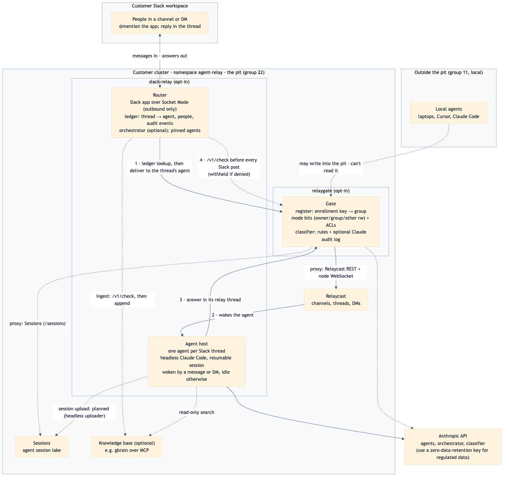

# Slack app for self-hosted Agent Relay (optional)

`slack-relay` lets people talk to agents running in your Agent Relay install
from Slack. It is optional: install it next to an existing `agent-relay`
release, or turn it on in the umbrella chart with `components.slackRelay`.

- Someone @mentions the app in a channel, or DMs it if you allow DMs. An agent
  picks up the thread.
- Follow-ups in that thread go to the same agent, with its context, however
  long the gap. Several people can talk in one thread at once.
- Each thread gets its own agent. The agents live on your relay and can see
  each other, so they can ask one another for help.
- Agents, sessions and the routing record stay inside your cluster. Slack only
  receives what an agent posts back into its thread.

## How it works



([SVG](diagrams/slack-relay-relaygate.svg) · source [slack-relay-relaygate.mmd](diagrams/slack-relay-relaygate.mmd); relaygate is optional, without it the router and host talk to Relaycast directly.)

One message, end to end:


([SVG](diagrams/slack-relay-flow.svg) · source [slack-relay-flow.mmd](diagrams/slack-relay-flow.mmd))


| Piece | Kind | What it does |
| --- | --- | --- |
| Router | Deployment, 1 replica, PVC | Holds the Slack connection. Records every message in the **ledger**: threads, the people in them, agents, and an append-only event log. Routes by ledger lookup and asks the orchestrator only about threads nobody owns yet. It is the only component with Slack credentials. |
| Orchestrator | in the router | Each Slack thread gets its own agent; that is enforced in code. A Claude model (default `claude-fable-5-2`) that sees every agent, its status, what it's working on and whose threads it holds, decides only whether a new thread goes to a pinned agent (`router.knownAgents`) instead. With no pinned agents it isn't called. `router.allowAgentReuse: true` lets it also hand a thread to an agent that already owns others. |
| Agent host | StatefulSet, 1 replica, PVC | Runs the per-thread agents with headless Claude Code (default `claude-opus-5-5`). Each agent is its own relay identity with its own workdir and Claude session on the volume. It runs no process between messages: the host keeps only each agent's relay connection, like a node, and a routed Slack message or a direct message on the relay (from a person or another agent) wakes the agent and resumes its session. A DM is answered by DM; an agent's automatic answer to another agent's DM gets no reply back, so agents can't loop. It has no Slack credentials. |

Restarts are safe. The ledger and the sessions live on volumes. Agents
re-register on the relay under the same name with a recovery proof derived
from a stable secret, so no agent tokens are stored.

## Requirements

- An `agent-relay` install with Relaycast reachable from the namespace, for
  example `http://relaycast:8787`.
- A Relaycast workspace key (`rk_live_...`) for the workspace the agents join.
- An Anthropic API key. Agents run Claude Code, and the default orchestrator is
  a Claude model.
- A Slack workspace where you can create apps.
- Outbound HTTPS from the namespace to `slack.com`, `wss-*.slack.com` (Socket
  Mode) and `api.anthropic.com`. No inbound traffic is needed in Socket Mode.

## 1. Create the Slack app

You create the app in your own Slack workspace from our manifest. The tokens
never leave your control.

1. Render the manifest. You can give the app your own name:
   ```sh
   components/slack-relay/manifest/render-manifest.py --name "Acme Agents" > manifest.json
   ```
2. In <https://api.slack.com/apps>, choose **Create New App**, then **From a
   manifest**. Pick your workspace and paste `manifest.json`.
3. In **Basic Information**, under **Display Information**, upload
   `components/slack-relay/manifest/app-icon.png` as the **App icon** (Slack
   manifests can't carry an icon). Then under **App-Level Tokens**, choose
   **Generate Token and Scopes**. Add the scope `connections:write` and copy the `xapp-...`
   token. Socket Mode uses this token.
4. In **Install App**, choose **Install to Workspace** and copy the **Bot User
   OAuth Token** (`xoxb-...`).
5. Invite the app to the channel(s) it should answer in (`/invite @Acme Agents`)
   and note each channel's ID (`C...`, under the channel name, then **About**).
   For a first rollout, start with a single channel and list only that one in
   `slack.allowedChannels`.

Bot scopes the manifest requests: `app_mentions:read`, `channels:history`,
`groups:history`, `im:history` (to read the threads it is in), `chat:write`
(to answer) and `channels:read` / `groups:read` (to refuse channels shared
outside the workspace). Events: `app_mention`, `message.channels`, `message.groups` and
`message.im`. The router ignores channel messages unless they mention the app
or are in a thread it already holds. It ignores DMs unless `slack.allowDms` is
set.

To receive events over HTTPS instead of Socket Mode, render the manifest with
`--mode http --url https://<host>/slack/events`. Then set `slack.mode: http`,
`ingress.*` and `secrets.slackSigningSecret`. In http mode only
`/slack/events` is exposed.

## 2. Create the Secrets

The chart only references Secrets, so create them however you manage secrets
(External Secrets, Secret Manager CSI, `kubectl`):

```sh
kubectl -n agent-relay create secret generic slack-relay-relaycast --from-literal=workspace-key="$RELAYCAST_WORKSPACE_KEY"
kubectl -n agent-relay create secret generic slack-relay-slack \
  --from-literal=bot-token="$SLACK_BOT_TOKEN" --from-literal=app-token="$SLACK_APP_TOKEN"
kubectl -n agent-relay create secret generic slack-relay-anthropic --from-literal=api-key="$ANTHROPIC_API_KEY"
```

## 3. Install

```yaml
# slack-relay-values.yaml
image:
  digest: sha256:<published digest>
relaycast:
  baseUrl: http://relaycast:8787
secrets:
  relaycastWorkspaceKey: { name: slack-relay-relaycast, key: workspace-key }
  slackBotToken: { name: slack-relay-slack, key: bot-token }
  slackAppToken: { name: slack-relay-slack, key: app-token }
  anthropicApiKey: { name: slack-relay-anthropic, key: api-key }
slack:
  allowedChannels: [C0123456789]
```

```sh
helm upgrade --install slack-relay charts/slack-relay -n agent-relay -f slack-relay-values.yaml
```

To install through the umbrella chart instead, set `components.slackRelay: true`
and put the same values under `slack-relay:`.

## 4. Check it

```sh
kubectl -n agent-relay logs deploy/slack-relay-router      # "socket mode connected"
kubectl -n agent-relay logs statefulset/slack-relay-host   # "registered relay agent slack-agent-host"
```

@mention the app in the allowed channel. The router logs `assigned <channel>:<ts>
-> slack-<channel>-<ts>`, the host logs `woke …` and `… answered`, and the
answer appears in the thread. Reply in the thread and the same agent answers
(`(resumed)` in the host log).

The ledger can be read from inside the cluster:

```sh
kubectl -n agent-relay port-forward deploy/slack-relay-router 8080
curl -s localhost:8080/ledger/roster   # agents, status, what they're doing, their threads and people
curl -s localhost:8080/ledger/events   # append-only routing log: inbound, assign, agent.*, outbound
```

## Knowledge base: answer from it, ingest into it (optional)

Give the agents a remote MCP server (e.g. a gbrain company brain) and stream
the channels the app is in into it:

```yaml
mcpServers:
  - { name: brain, url: https://brain.example.com/mcp, tokenUrl: https://brain.example.com/token,
      scope: read, clientId: slack-agents, clientSecret: { name: slack-relay-brain, key: read-client-secret } }
  - { name: brain-write, url: https://brain.example.com/mcp, tokenUrl: https://brain.example.com/token,
      scope: write, clientId: slack-ingest, clientSecret: { name: slack-relay-brain, key: write-client-secret } }
host:
  mcpServers: [brain]
  allowedTools: ["Read(./**)", "Glob(./**)", "Grep(./**)", mcp__relaycast, mcp__brain]
  persona: "You are the company brain. Search the brain before answering and cite what you found."
ingest:
  enabled: true
  mcpServer: brain-write
  sourceId: company
```

Agents get a fresh OAuth token for each turn. Ingest appends every human
message (top level and in threads) to `slack/<channel name>-<channel id>/<YYYY-MM-DD>`
as it arrives; it is idempotent per Slack message, skips bots, withholds
messages that look like credentials, skips private channels unless
`ingest.privateChannels`, and never touches channels shared outside the
workspace.

### More than one source

`ingest.sourceRules` and `ingest.privateSourceId` send some channels to other
sources (e.g. `founders`). gbrain lets a remote client write only to its own
write source, so give each extra source its own write-scoped client and map it:

```yaml
mcpServers:
  # ...brain and brain-write as above, plus one per extra source:
  - { name: brain-write-founders, url: https://brain.example.com/mcp, tokenUrl: https://brain.example.com/token,
      scope: write, clientId: <founders client id>, clientSecret: { name: slack-relay-brain, key: write-founders-client-secret } }
ingest:
  sourceServers:
    founders: brain-write-founders
```

A source with no entry is written through `ingest.mcpServer`, and gbrain
refuses it (nothing is misfiled). Agents never get a write-scoped server
unless `host.mcpServers` names it: with `host.mcpServers` empty they get the
read-scoped ones only.

### Backfill a channel's history

Live ingest starts when the app joins a channel. To bring in what was said
before, run the backfill with the router's environment, in the router pod or
on its host:

```sh
kubectl exec -n agent-relay deploy/slack-relay-router -- \
  node src/backfill.ts --channel C0123456789 [--channel ...] [--since 2026-01-01] [--dry-run]
```

It reads the channel's history and thread replies through the bot token
(`channels:history`, `groups:history`) and writes them through the same
ingest, oldest first, applying the same rules: `slack.allowedChannels`, no
DMs, the same pages and sources, shared channels refused, private ones only
with `ingest.privateChannels`, and messages that look like credentials
withheld. `--since` keeps replies posted after the date in threads that
started before it. On a day live ingest has already started, backfilled lines
are appended after the live ones; every line carries its UTC time. Every write is keyed by its
Slack message, so a backfill can be re-run or overlap live ingest without
duplicating a line. `--dry-run` reports counts and target sources without
writing. With relaygate on, it registers as `<router name>-backfill` and every
write is checked like live ingest.

## Governance with relaygate (optional)

[relaygate](https://github.com/AgentWorkforce/relaygate) (install: [self-hosted-relaygate.md](self-hosted-relaygate.md)) puts a permission
gate between agents and Relaycast/Sessions: agents belong to a group (set at
registration), every request is checked against mode bits, and anything that
crosses a group boundary or leaves through Slack is classified first. It is
opt-in:

```yaml
relaygate:
  # The gate's Service: <release>-relaygate in the umbrella (components.relaygate),
  # or the release name of a standalone relaygate install.
  url: http://agent-relay-relaygate:8080
secrets:
  relaygateEnrollmentKey: { name: slack-relay-relaygate, key: enrollment-key }  # the pit group's key
  agentIdentitySecret: { name: slack-relay-relaygate, key: identity-secret }
```

With it on:

- every agent (router, host, one per thread) registers through relaygate with
  the enrollment key, which decides its group, and gets its identity back after
  a restart with a recovery proof derived from `agentIdentitySecret`;
- all Relaycast traffic, including each agent's relay tools, goes through the
  gate with the agent's `rg_` token. No pod holds a Relaycast credential;
- every Slack post and every knowledge-base write is asked of relaygate first
  (`/v1/check`). A denial is final: an agent's answer is withheld and the
  thread is told; an unavailable gate is retried, then nothing is sent;
- a DM reply relaygate denies (a pit agent answering an outside agent) is
  dropped, not retried.

Two things on the relaygate side make this work:

- **The proxy is on** (`proxy.relaycastUrl` in the relaygate values), so the
  gate can reach Relaycast for the agents, and Relaycast's own NetworkPolicy
  admits only the gate (see [self-hosted-relaygate.md](self-hosted-relaygate.md)).
- **The routing channel belongs to the pit.** The chart's default policy gives
  `relaycast:channel/slack` to the pit, matching the default `relaycast.channel`
  (`slack`). If your policy only grants a prefix such as `relaycast:channel/slack-`,
  set `relaycast.channel` to match (e.g. `slack-pit`); otherwise the router
  can't create its channel. Agent names start with `slack-`, so the bridge
  enrollment key's `namePrefix` must be `slack-`.

## Data boundaries and audit

- **What leaves the cluster:** Slack API calls from the router only, and
  Anthropic API calls from the router (orchestrator) and the host (agents).
  Agents have no Slack credentials and post only through the relay.
- **Agent tools:** by default `Read`, `Glob` and `Grep` scoped to the agent's
  own workdir (`./**`), plus the relay tools. No shell, no web fetch/search,
  `/proc` denied, and `permissionMode: dontAsk`, so any other tool call is
  refused. An agent can't read another thread's files or the pod's
  environment (API keys). Widen `host.allowedTools` deliberately. Each tool
  you add is a new way for data to leave.
- **Audit trail:** the ledger's `events` table records every inbound Slack
  message (who, where, when, truncated text), every routing decision (who
  decided: `orchestrator:<model>` or `deterministic`) and every outbound post.
  The agents' full Claude sessions are JSONL files on the host volume
  (`/data/home/.claude/projects/...`).
- For a hard egress boundary, add a NetworkPolicy or a firewall egress rule
  that allows only Relaycast, Slack and Anthropic from this namespace.

## Values reference

See `charts/slack-relay/values.yaml`. The ones you're most likely to change:

| Value | Default | |
| --- | --- | --- |
| `slack.allowedChannels` | `[]` (any channel the bot is in) | Channel IDs the app answers in. |
| `slack.allowDms` | `false` | Answer DMs to the bot. |
| `router.orchestrator` | `claude` | `deterministic` to skip the model and start one agent per thread. |
| `router.orchestratorModel` | `claude-fable-5-2` | |
| `router.knownAgents` | `[]` | Pinned agents the orchestrator may route to, e.g. a company knowledge agent. |
| `router.allowAgentReuse` | `false` | Let one agent own several threads. |
| `host.agentModel` | `claude-opus-5-5` | |
| `host.persona` | generalist | Appended to each agent's system prompt. |
| `host.allowedTools` | `[Read(./**), Glob(./**), Grep(./**), mcp__relaycast]` | Scoped to the agent's workdir. |
| `host.disallowedTools` | `[Bash, WebFetch, WebSearch, Read(//proc/**)]` | Always refused. |
| `host.idleReleaseMinutes` | `15` | |

## Limits of this version

- One router and one host replica. The ledger is single-writer SQLite and the
  sessions live on one volume, so this scales by machine size, not replica
  count.
- Each agent's turns run one at a time. Different threads run in parallel.
- An agent's awareness of other agents comes from the ledger roster in its
  prompt. Its relay tools are scoped to its own token, so it can message and
  read channels but not administer the workspace.
