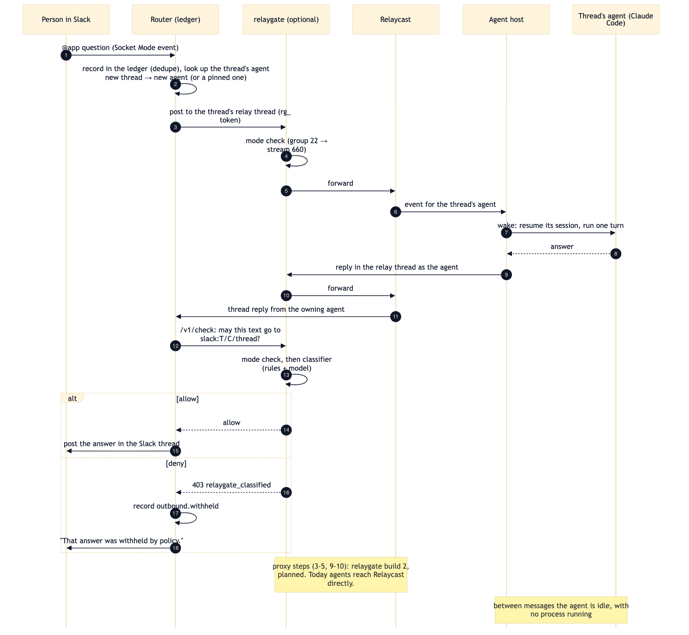

# Slack app for self-hosted Agent Relay (optional)

`slack-relay` lets people talk to agents running in your Agent Relay install
from Slack. It is optional: install it next to an existing `agent-relay`
release, or turn it on in the umbrella chart with `components.slackRelay`.

- Someone @mentions the app in a channel, or DMs it if you allow DMs. An agent
  picks up the thread.
- Follow-ups in that thread go to the same agent, with its context, however
  long the gap. Several people can talk in one thread at once.
- Each thread gets its own agent. The agents live on your relay and can see
  each other, so they can ask one another for help.
- Agents, sessions and the routing record stay inside your cluster. Slack only
  receives what an agent posts back into its thread.

## How it works


([SVG](diagrams/slack-relay-relaygate.svg) · source [slack-relay-relaygate.mmd](diagrams/slack-relay-relaygate.mmd); relaygate is optional, without it the router and host talk to Relaycast directly.)

One message, end to end:



([SVG](diagrams/slack-relay-flow.svg) · source [slack-relay-flow.mmd](diagrams/slack-relay-flow.mmd))


| Piece | Kind | What it does |
| --- | --- | --- |
| Router | Deployment, 1 replica, PVC | Holds the Slack connection. Records every message in the **ledger**: threads, the people in them, agents, and an append-only event log. Routes by ledger lookup and asks the orchestrator only about threads nobody owns yet. For each message it routes it sends an :eyes: reaction request as soon as it takes the message, before routing, and does not wait for it, so the reaction usually shows before the agent starts but can land later or fail without affecting the answer (`slack.ackReaction`). It is the only component with Slack credentials. |
| Orchestrator | in the router | Each Slack thread gets its own agent; that is enforced in code. A Claude model (default `claude-fable-5-2`) that sees every agent, its status, what it's working on and whose threads it holds, decides only whether a new thread goes to a pinned agent (`router.knownAgents`) instead. With no pinned agents it isn't called. `router.allowAgentReuse: true` lets it also hand a thread to an agent that already owns others. |
| Agent host | StatefulSet, 1 replica, PVC | Runs the per-thread agents with headless Claude Code (default `claude-opus-5-5`). Each agent is its own relay identity with its own workdir and Claude session on the volume. It runs no process between messages: the host keeps only each agent's relay connection, like a node, and a routed Slack message or a direct message on the relay (from a person or another agent) wakes the agent and resumes its session. A DM is answered by DM; an agent's automatic answer to another agent's DM gets no reply back, so agents can't loop. Behind relaygate a DM from outside the pit gets no answer at all (see "Messages from outside the pit"). It has no Slack credentials. |

Restarts are safe. The ledger and the sessions live on volumes. Agents
re-register on the relay under the same name with a recovery proof derived
from a stable secret, so no agent tokens are stored.

## Requirements

- An `agent-relay` install with Relaycast reachable from the namespace, for
  example `http://relaycast:8787`.
- A Relaycast workspace key (`rk_live_...`) for the workspace the agents join.
- An Anthropic API key. Agents run Claude Code, and the default orchestrator is
  a Claude model.
- A Slack workspace where you can create apps.
- Outbound HTTPS from the namespace to `slack.com`, `wss-*.slack.com` (Socket
  Mode) and `api.anthropic.com`. No inbound traffic is needed in Socket Mode.
  With [GitHub repos](#github-repos-optional) on, also `github.com` and
  `api.github.com` (or your GitHub Enterprise host).

## 1. Create the Slack app

You create the app in your own Slack workspace from our manifest. The tokens
never leave your control.

1. Render the manifest. You can give the app your own name:
   ```sh
   components/slack-relay/manifest/render-manifest.py --name "Acme Agents" > manifest.json
   ```
2. In <https://api.slack.com/apps>, choose **Create New App**, then **From a
   manifest**. Pick your workspace and paste `manifest.json`.
3. In **Basic Information**, under **Display Information**, upload
   `components/slack-relay/manifest/app-icon.png` as the **App icon** (Slack
   manifests can't carry an icon). Then under **App-Level Tokens**, choose
   **Generate Token and Scopes**. Add the scope `connections:write` and copy the `xapp-...`
   token. Socket Mode uses this token.
4. In **Install App**, choose **Install to Workspace** and copy the **Bot User
   OAuth Token** (`xoxb-...`).
5. Invite the app to the channel(s) it should answer in (`/invite @Acme Agents`)
   and note each channel's ID (`C...`, under the channel name, then **About**).
   For a first rollout, start with a single channel and list only that one in
   `slack.allowedChannels`.

Bot scopes the manifest requests: `app_mentions:read`, `channels:history`,
`groups:history`, `im:history` (to read the threads it is in), `chat:write`
(to answer), `reactions:write` (to put :eyes: on each message it routes, so
people see it was picked up) and `channels:read` / `groups:read` (to refuse
channels shared outside the workspace). Events: `app_mention`, `message.channels`, `message.groups` and
`message.im`. The router ignores channel messages unless they mention the app
or are in a thread it already holds. It ignores DMs unless `slack.allowDms` is
set. Ignored messages get no reaction.

**Existing installs:** the reaction needs a slack-relay image from chart 0.3.11
or later. An app created from an older manifest also lacks
`reactions:write`. Add it under **OAuth & Permissions**, **Bot Token Scopes**,
then reinstall the app to the workspace (**Install App**, **Reinstall to
Workspace**); the bot token stays the same. Until then the router logs
`ack reaction off: the bot token lacks reactions:write (add reactions:write and
reinstall the app)` once, adds no reactions, and routes as before. Once it has
logged that, it stops trying until it restarts, so after the reinstall restart
the router, standalone or in the umbrella:
`kubectl -n agent-relay rollout restart deployment -l app.kubernetes.io/name=slack-relay,app.kubernetes.io/component=router`.
To turn the reaction off, set `slack.ackReaction: ""`.

To receive events over HTTPS instead of Socket Mode, render the manifest with
`--mode http --url https://<host>/slack/events`. Then set `slack.mode: http`,
`ingress.*` and `secrets.slackSigningSecret`. In http mode only
`/slack/events` is exposed.

## 2. Create the Secrets

The chart only references Secrets, so create them however you manage secrets
(External Secrets, Secret Manager CSI, `kubectl`):

```sh
kubectl -n agent-relay create secret generic slack-relay-relaycast --from-literal=workspace-key="$RELAYCAST_WORKSPACE_KEY"
kubectl -n agent-relay create secret generic slack-relay-slack \
  --from-literal=bot-token="$SLACK_BOT_TOKEN" --from-literal=app-token="$SLACK_APP_TOKEN"
kubectl -n agent-relay create secret generic slack-relay-anthropic --from-literal=api-key="$ANTHROPIC_API_KEY"
```

## 3. Install

```yaml
# slack-relay-values.yaml
image:
  digest: sha256:<published digest>
relaycast:
  baseUrl: http://relaycast:8787
secrets:
  relaycastWorkspaceKey: { name: slack-relay-relaycast, key: workspace-key }
  slackBotToken: { name: slack-relay-slack, key: bot-token }
  slackAppToken: { name: slack-relay-slack, key: app-token }
  anthropicApiKey: { name: slack-relay-anthropic, key: api-key }
slack:
  allowedChannels: [C0123456789]
```

```sh
helm upgrade --install slack-relay charts/slack-relay -n agent-relay -f slack-relay-values.yaml
```

To install through the umbrella chart instead, set `components.slackRelay: true`
and put the same values under `slack-relay:`.

## 4. Check it

```sh
kubectl -n agent-relay logs deploy/slack-relay-router      # "socket mode connected"
kubectl -n agent-relay logs statefulset/slack-relay-host   # "registered relay agent slack-agent-host"
```

@mention the app in the allowed channel. The router logs `assigned <channel>:<ts>
-> slack-<channel>-<ts>`, the host logs `woke …` and `… answered`, and the
answer appears in the thread. Reply in the thread and the same agent answers
(`(resumed)` in the host log).

The ledger can be read from inside the cluster:

```sh
kubectl -n agent-relay port-forward deploy/slack-relay-router 8080
curl -s localhost:8080/ledger/roster   # agents, status, what they're doing, their threads and people
curl -s localhost:8080/ledger/events   # append-only routing log: inbound, assign, agent.*, outbound
```

## Knowledge base: answer from it, ingest into it (optional)

Give the agents a remote MCP server (e.g. a gbrain company brain) and stream
the channels the app is in into it:

```yaml
mcpServers:
  - { name: brain, url: https://brain.example.com/mcp, tokenUrl: https://brain.example.com/token,
      scope: read, clientId: slack-agents, clientSecret: { name: slack-relay-brain, key: read-client-secret } }
  - { name: brain-write, url: https://brain.example.com/mcp, tokenUrl: https://brain.example.com/token,
      scope: write, clientId: slack-ingest, clientSecret: { name: slack-relay-brain, key: write-client-secret } }
host:
  mcpServers: [brain]
  allowedTools: ["Read(./**)", "Glob(./**)", "Grep(./**)", mcp__relaycast, mcp__brain]
  persona: "You are the company brain. Search the brain before answering and cite what you found."
ingest:
  enabled: true
  mcpServer: brain-write
  sourceId: company
```

Agents get a fresh OAuth token for each turn. Ingest appends every human
message (top level and in threads) to `slack/<channel name>-<channel id>/<YYYY-MM-DD>`
as it arrives; it is idempotent per Slack message, skips bots, withholds
messages that look like credentials, skips private channels unless
`ingest.privateChannels`, and never touches channels shared outside the
workspace.

### More than one source

`ingest.sourceRules` and `ingest.privateSourceId` send some channels to other
sources (e.g. `founders`). gbrain lets a remote client write only to its own
write source, so give each extra source its own write-scoped client and map it:

```yaml
mcpServers:
  # ...brain and brain-write as above, plus one per extra source:
  - { name: brain-write-founders, url: https://brain.example.com/mcp, tokenUrl: https://brain.example.com/token,
      scope: write, clientId: <founders client id>, clientSecret: { name: slack-relay-brain, key: write-founders-client-secret } }
ingest:
  sourceServers:
    founders: brain-write-founders
```

A source with no entry is written through `ingest.mcpServer`, and gbrain
refuses it (nothing is misfiled). Agents never get a write-scoped server
unless `host.mcpServers` names it: with `host.mcpServers` empty they get the
read-scoped ones only.

### Backfill a channel's history

Live ingest starts when the app joins a channel. To bring in what was said
before, run the backfill with the router's environment, in the router pod or
on its host:

```sh
kubectl exec -n agent-relay deploy/slack-relay-router -- \
  node src/backfill.ts --channel C0123456789 [--channel ...] [--since 2026-01-01] [--dry-run]
```

It reads the channel's history and thread replies through the bot token
(`channels:history`, `groups:history`) and writes them through the same
ingest, oldest first, applying the same rules: `slack.allowedChannels`, no
DMs, the same pages and sources, shared channels refused, private ones only
with `ingest.privateChannels`, and messages that look like credentials
withheld. `--since` keeps replies posted after the date in threads that
started before it. On a day live ingest has already started, backfilled lines
are appended after the live ones; every line carries its UTC time. Every write is keyed by its
Slack message, so a backfill can be re-run or overlap live ingest without
duplicating a line. `--dry-run` reports counts and target sources without
writing. With relaygate on, it registers as `<router name>-backfill` and every
write is checked like live ingest.

## GitHub repos (optional)

Let the agents read your code. A `repo-sync` sidecar in the agent host pod
keeps a read-only copy of each repository at `/repos/<owner>/<name>`, and the
agents get `Read`, `Glob` and `Grep` on `/repos`. They still have no shell, and
they never see the GitHub token.

Two ways to give the sidecar access: a **GitHub App** (recommended: no
personal token to renew, short-lived tokens, the installation's repository
selection is the list) or a fine-grained personal access token.

### 1. Register a GitHub App (recommended)

You need to be an **owner of the GitHub organization** that owns the
repositories (or, for personal repositories, that account).

#### With the registration helper

On a machine with a browser, Node 22.18 or later, a checkout of this
repository, and `kubectl` pointed at the cluster (or `gcloud` signed in to
the project):

```sh
cd components/slack-relay/manifest
# Kubernetes Secret agent-relay/slack-relay-github-app (app-id, private-key, installation-id):
node register-github-app.mts --org <org> --k8s-namespace agent-relay
# or Google Secret Manager (github-app-id, github-app-private-key, github-app-installation-id):
node register-github-app.mts --org <org> --gcp-project <project>
```

1. Your browser opens GitHub's *Create GitHub App* page with the app
   filled in from [`github-app-manifest.json`](../components/slack-relay/manifest/github-app-manifest.json):
   Contents and Metadata read-only, no webhook, private. Pick a name (or pass
   `--name`) and click **Create GitHub App**.
2. GitHub sends you back to the helper with a one-time code. The helper
   exchanges it (`POST /app-manifests/<code>/conversions`) for the app ID and
   private key and writes them to the store. It never prints them.
3. The browser moves on to the app's install page. Choose *Only select
   repositories*, pick the ones the agents may read, and click **Install**.
4. GitHub sends you back with the installation ID. The helper mints a token
   for that installation, stores the ID, and lists the repositories it can
   read (names only).

The helper listens on `127.0.0.1` only and must finish within an hour (the
code's lifetime). The app keeps the helper's local address as its Setup URL,
which GitHub uses only when the app is installed again; clear it on the app's
General page if you like (editing the repository selection never goes
there). `--user` instead of `--org` registers the app on your own
account. `--github-url https://ghe.example.com` targets GitHub Enterprise
Server. `--out-dir <dir>` writes the three values as `0600` files for any
other secret manager. `--k8s-context` selects the kubectl context. Run
`node register-github-app.mts --help` for the rest.

With Secret Manager, sync the three secrets into a Kubernetes Secret
`slack-relay-github-app` with keys `app-id`, `private-key` and
`installation-id` (e.g. with External Secrets), then set the values below.

#### By hand

1. **Create the app.** Organization → Settings → Developer settings → GitHub
   Apps → **New GitHub App** (on github.com:
   `https://github.com/organizations/<org>/settings/apps/new`):
   - **GitHub App name:** anything, e.g. `<org> agent repos`.
   - **Homepage URL:** any URL, e.g. your intranet or this page.
   - **Webhook:** untick **Active**. The sidecar receives no webhooks.
   - **Repository permissions:** **Contents: Read-only** and **Metadata:
     Read-only**. Nothing else; no organization or account permissions, no
     events.
   - **Where can this GitHub App be installed?** *Only on this account*.
2. **Note the App ID** at the top of the app's General page.
3. **Generate a private key** (General → Private keys → *Generate a private
   key*). GitHub downloads a `.pem` file; that file is the credential, keep it
   in your secret manager and delete the download afterwards.
4. **Install the app** (the app's page → *Install App* → your organization):
   choose *Only select repositories* and pick the ones the agents may read.
   After installing, the URL ends in `/installations/<id>`: that number is
   the **installation ID**.

The installation's repository selection is the only list you need to keep:
leave `repos.list` empty and the sidecar syncs every repository the
installation can read (`GET /installation/repositories`), re-listed on every
refresh. Add a repository to the installation and it appears on the next
refresh; remove one and it is deleted from `/repos` on the next refresh.

On GitHub Enterprise Server, create the app the same way on your server and
set `repos.host`.

Create the Secret (the helper has already done this), from your secret manager or the downloaded key:

```sh
kubectl -n agent-relay create secret generic slack-relay-github-app \
  --from-literal=app-id=<app id> \
  --from-literal=installation-id=<installation id> \
  --from-file=private-key=./<app-name>.<date>.private-key.pem
```

Turn it on:

```yaml
repos:
  enabled: true
  app:
    # app-id, installation-id and private-key all come from this Secret.
    # appId / installationId set here instead override the Secret's keys.
    privateKey: { name: slack-relay-github-app, key: private-key }
  list: []          # empty: every repo the installation can read
  refreshMinutes: 15
  # host: ghe.example.com        # GitHub Enterprise Server (or https://ghe.example.com)
  # apiUrl: ""                   # default https://api.github.com, or <host>/api/v3 on GHE
  # sizeLimit: 5Gi               # cap on the checkouts; the pod is evicted past it
```

The sidecar signs a JWT (RS256, valid 10 minutes) with the private key,
exchanges it for an installation token limited to `contents:read` and
`metadata:read` (`POST /app/installations/<id>/access_tokens`), and asks for
a new one before the hour-long token gets close to expiring.

Set exactly one of `repos.app.privateKey.name` and `repos.token.name`.

### Or: a fine-grained personal access token

Use a fine-grained personal access token (GitHub → Settings → Developer
settings → Personal access tokens → Fine-grained tokens):

- **Resource owner:** the organization (or user) that owns the repositories.
  An organization may have to approve the token.
- **Expiration:** set one (e.g. 90 days) and put the renewal in your calendar.
  When it expires, syncing stops and the agents keep the last copies.
- **Repository access:** *Only select repositories*, and pick the ones the
  agents may read.
- **Permissions:** Repository → **Contents: Read-only** (Metadata: Read-only
  is added automatically). Nothing else.

With a fine-grained token, its repository selection is the only list you need
to keep: leave `repos.list` empty and the sidecar syncs every repository the
token can read, re-listed on every refresh. Avoid a classic token or *All
repositories*: the agents would then get every repository the account can
read.

On GitHub Enterprise Server, create the same token there and set `repos.host`.

```sh
kubectl -n agent-relay create secret generic slack-relay-github --from-literal=token="$GITHUB_TOKEN"
```

```yaml
repos:
  enabled: true
  token: { name: slack-relay-github, key: token }
  # Empty: every repo the token can read. Or pin a list (and refs):
  # list:
  #   - example-org/api                                  # default branch
  #   - { repo: example-org/web, ref: release/2026 }      # branch, tag or commit
  list: []
  refreshMinutes: 15
```

### Check it

`helm upgrade` restarts the host pod. The first sync runs at start; the
sidecar logs one line per repository with its commit:

```sh
kubectl -n agent-relay logs statefulset/slack-relay-host -c repo-sync
# repo-sync: GitHub App installation can read 2 repo(s)   (or: token can read ...)
# repo-sync: example-org/api 3f2c... updated
# repo-sync: example-org/web@release/2026 9a41... updated
```

### What the agents see

- `/repos/<owner>/<name>`: the files at the synced commit, mounted read-only.
  No `.git` directory (no history), no submodules, no Git LFS content (LFS
  files are pointer files), and symlinks inside a repository are plain files
  holding the link target, so a repository can't point an agent elsewhere.
- Their system prompt says where the repositories are (and lists them when
  `repos.list` is set). They read them with absolute paths, e.g.
  `Grep` in `/repos/example-org/api`.
- The chart adds `Read(//repos/**)`, `Glob(//repos/**)` and `Grep(//repos/**)`
  to `host.allowedTools` (`//` is the filesystem root in Claude Code's
  permission rules). Each agent's own workdir stays its only other readable
  path: one agent still can't read another's files.
- A refresh checks a changed repository out beside `/repos` and swaps it in
  with two renames, so the path is missing only for the instant between them;
  if the new tree can't be moved in, the old one stays. Between refreshes the
  copy can be up to `refreshMinutes` behind. A fetch or listing that stalls is
  stopped after 10 minutes and retried on the next refresh.

### Where the token and the app key go

- The GitHub App's private key is a Secret volume mounted only in the
  `repo-sync` container (not in its environment, so git never sees it); the
  installation tokens minted from it live only in that container's shell and
  expire within the hour. The rest of this section applies to them as to a
  personal token.
- A personal token goes only into the `repo-sync` container's environment, from your Secret. The host
  container, and so the agents, never get it, and containers in a pod don't
  share a process namespace, so `/proc` can't reach it either.
- Git gets it through `GIT_ASKPASS`, which reads it from that environment. It
  is never put in a clone URL, a remote, a git config or a credential store.
  The bare caches the sidecar fetches into have no remote and live on a volume
  the host doesn't mount; the checkouts have no `.git`.
- Listing repositories (`repos.list` empty) calls `GET /user/repos` (or
  `GET /installation/repositories` for an app) with the token in the
  `Authorization` header, on the API origin only.
- Logs carry repository names, refs and commit SHAs, never the token, the
  JWT or the key; a git
  error line is masked should it ever contain it.

### Network

Allow outbound HTTPS from the namespace to `github.com` and `api.github.com`
(or your GitHub Enterprise host). `api.github.com` is needed for a GitHub App
(token exchange) and whenever `repos.list` is empty.

## Governance with relaygate (optional)

[relaygate](https://github.com/AgentWorkforce/relaygate) (install: [self-hosted-relaygate.md](self-hosted-relaygate.md)) puts a permission
gate between agents and Relaycast/Sessions: agents belong to a group (set at
registration), every request is checked against mode bits, and anything that
crosses a group boundary or leaves through Slack is classified first. It is
opt-in:

```yaml
relaygate:
  # The gate's Service is <release>-relaygate (a release whose name already
  # contains "relaygate" uses the release name): agent-relay-relaygate in the
  # umbrella, relaygate for a standalone release named relaygate.
  url: http://agent-relay-relaygate:8080
secrets:
  relaygateEnrollmentKey: { name: slack-relay-relaygate, key: enrollment-key }  # the pit group's key
  agentIdentitySecret: { name: slack-relay-relaygate, key: identity-secret }
```

With it on:

- every agent (router, host, one per thread) registers through relaygate with
  the enrollment key, which decides its group, and gets its identity back after
  a restart with a recovery proof derived from `agentIdentitySecret`;
- all Relaycast traffic, including each agent's relay tools, goes through the
  gate with the agent's `rg_` token. No pod holds a Relaycast credential;
- every Slack post and every knowledge-base write is asked of relaygate first
  (`/v1/check`). A denial is final: an agent's answer is withheld and the
  thread is told; an unavailable gate is retried, then nothing is sent;
- a DM is answered only if relaygate allows it: see "Messages from outside
  the pit" below.

Two things on the relaygate side make this work:

- **The proxy is on** (`proxy.relaycastUrl` in the relaygate values), so the
  gate can reach Relaycast for the agents, and Relaycast's own NetworkPolicy
  admits only the gate (see [self-hosted-relaygate.md](self-hosted-relaygate.md)).
- **The routing channel belongs to the pit.** The chart's default policy gives
  `relaycast:channel/slack` to the pit, matching the default `relaycast.channel`
  (`slack`). If your policy only grants a prefix such as `relaycast:channel/slack-`,
  set `relaycast.channel` to match (e.g. `slack-pit`); otherwise the router
  can't create its channel. Agent names start with `slack-`, so the bridge
  enrollment key's `namePrefix` must be `slack-`.

### Messages from outside the pit

Agents outside the pit (for example people's local agents in another group)
may DM a Slack thread agent, if the policy lets them write to its inbox. The
agent takes the message in, but nothing ever goes back to them:

- **The turn runs.** The agent reads the DM in its own session, and the
  session uploads as usual. It can still act inside the pit with its tools.
- **No reply is attempted.** Before answering any DM, the host asks relaygate
  `POST /v1/check` with the agent's own `rg_` token, `op: "w"` on the
  sender's inbox (`relaycast:inbox/<sender>`): once before the turn, and again
  with the exact answer text just before it is sent. It sends only on
  `allow`. A denial, an unknown recipient or a gate that doesn't answer (after
  retries) withholds the reply, and the host logs
  `<agent>: reply withheld: recipient outside group (<sender>; denied | gate unavailable)`,
  names only, never message text.
- **The agent knows.** Behind relaygate every agent's system prompt says that
  outside senders can't be answered, and a DM from one says so in the prompt,
  so the agent doesn't promise a reply.
- **Automatic answers.** An agent's automatic answer to another agent's DM is
  never answered, inside the pit or out.

relaygate's policy already refuses pit-to-outside writes (the pit can't write
out), and its proxy enforces that on the send itself. The host check is an
extra check before sending, against the same policy: the host never attempts
a reply the gate hasn't allowed, so a gap in how the send is enforced (the
proxy off, a route it doesn't cover) doesn't become a leak, and a gate that
doesn't answer means no reply. It is not a separate same-group rule: if the
policy lets the pit write to an outside inbox and the classifier passes the
answer, the answer is sent. Keep outside inboxes (`relaycast:inbox/<prefix>`)
unwritable by the pit.

What the agent sends on its own with its relay tools (`mcp__relaycast`: a DM,
a channel post) goes through relaygate's proxy with its own `rg_` token, so
the same mode bits refuse a write into an outside inbox or channel. The host
adds nothing there. The Slack thread answers go to the pit's routing channel,
which outside groups can't read under the default policy.

`host.replyToOutside` (default `false`) can't turn any of this off: behind
relaygate it is ignored (the host logs that). Without relaygate there are no
groups, and DMs are answered as before.

### What the agents see on the relay

Behind relaygate there is no Relaycast workspace key anywhere in the Slack
app: relaygate holds it. Relaycast's MCP lists agents only with a workspace
key (its `agent.list` refuses before asking anyone), so a gated agent can't
list agents with `mcp__relaycast`. Instead each agent gets **`mcp__relay_agents`**
(`host.relayAgentsMcp`, default `true`; it only applies with relaygate):

- `list_agents` (filter `status`: `online`, `offline`, `all`; `include_stale`;
  `query` on name or persona; pages of up to 50 with `offset`/`next_offset`,
  so every visible agent is reachable) and `get_agent` (one agent's status,
  persona and card). Each is a `GET` to
  relaygate's `/v1/agents` or `/v1/agents/<name>` with the agent's own `rg_`
  token; there are no write tools. relaygate answers with its workspace key
  and shows only the agents its policy lets this agent see. Credential-looking
  fields are dropped from what the agent gets.
- `mcp__relaycast__agent_list` and the `mcp__relaycast__workspace_*` tools are
  refused for gated agents (added to the disallowed tools): they can only fail
  without a workspace key, and their error reads like a setup problem.
- The system prompt says the agent can see every agent on the relay, can
  message agents in its own group, and can't message agents outside it (such
  as people's local, desktop or editor agents), and never to blame a missing
  workspace key.

Which agents an agent sees is relaygate's policy. It sees an agent when it may
write or read that agent's inbox (`relaycast:inbox/<name>`), or read its
**directory entry** `relaycast:agent/<name>`. A directory entry only shows the
agent (name, status, persona, card): it never lets the agent message it, and
agents can't create entries themselves. To let the pit (gid 22) see every
agent on the relay, including desktop and editor agents whose names no inbox
prefix covers, the relaygate chart's default policy has:

```yaml
policy:
  streamDefaults:
    # Visibility only: the pit sees every agent; messaging still needs w on the inbox.
    - { prefix: "relaycast:agent/", gid: 22, mode: "040" }
```

If you replace `policy.streamDefaults`, keep that line. It needs a relaygate
image with the agent directory (relaygate#41); older images ignore it, and the
pit then sees only the agents whose inbox it may read or write (with the
default policy: its own group and `local-*`). Messaging is unchanged: a DM to
an agent outside the pit is still refused by relaygate (`relaygate_denied`),
because the pit has no `w` on outside inboxes. To check what an agent sees:
`npm run explain -- --policy policy.json --as key:pit --op r --stream relaycast:agent/<name>`
in the relaygate repo.

### Session upload (optional)

With relaygate on, the host can upload every agent's Claude Code session to
Agent Relay Sessions, so each Slack thread's agent shows up in the dashboard
like a Desktop session (title `<agent> · Slack <channel id> thread <thread ts>`,
first prompt, every user and assistant message; tool calls appear by name).
The ids go in the title. The thread's text goes in the session itself.

```yaml
sessions:
  upload:
    enabled: true
    orgId: <relay-control organization id>
    workspaceId: <relay-control workspace id>
    # baseUrl defaults to <relaygate.url>/sessions (the gate's main port)
    relayControlUrl: http://relay-control   # relay-control's Service (port 80)
secrets:
  sessionsEnrollmentKey: { name: slack-relay-sessions, key: enrollment-key }
```

- **Ownership.** Each upload carries the agent's own `rg_` token, so relaygate
  makes the agent the session's owner, in the agent's group (the pit, gid 22).
  Who can read it comes from the relaygate policy's `sessionDefaults` for that
  group. For example, `{"gid": 22, "mode": "660", "acl": [{"gid": 11, "perm": "w"}, {"gid": 33, "perm": "r"}]}`
  lets the pit and the groups in the ACL read it. A per-session
  `sessionOverrides` entry shares one session more widely.
- **When.** The upload runs after every turn (thread message or DM), and at
  startup for every known agent. Only complete transcript lines past a
  per-session cursor on the host volume (`/data/sessions-upload/cursors`) are
  sent, in native delivery batches (`POST <sessions>/v1/delivery/batches`).
  Batch ids are derived from their content, so a retry is an exact replay.
  429 and 503 wait for `Retry-After`. Other 5xx and network errors back off,
  and after a few attempts the upload waits for the next turn. A relaygate
  denial (403 `relaygate_*`) is final for that session. Transcript text and
  tokens are never logged.
- **The Sessions credential.** Sessions' ingest edge accepts only a
  relay-control user session with `rth:sync`. Workspace API tokens are
  refused, and an access token lasts 24 hours. So the host holds its own
  credential. An organization owner or admin mints a Desktop enrollment key for
  the user the sessions are uploaded as (`POST /api/v1/workspaces/<id>/deployment-api-tokens`,
  `{"purpose": "desktop-enrollment", "email": "<uploader>", "label": "slack-relay"}`)
  and stores it in the Secret. The host exchanges it once
  (`/api/v1/auth/enrollment/token`), keeps the session in
  `/data/sessions-upload/.credential.json` and refreshes it. Each upload then
  sends `X-Relaygate-Token: <agent rg_>` and `Authorization: Bearer <session>`,
  and relaygate forwards the credential unchanged. The key works only once and
  expires in at most 30 days. Exchange it soon after minting, and keep the
  volume: if the stored session is lost or revoked, mint a new key.
  Sessions records that user as the uploader. relaygate records the agent as
  the owner.
- **Without `relayControlUrl`**, uploads send the `rg_` token in
  `Authorization` and relaygate uses its own `SESSIONS_TOKEN`. With
  `SESSIONS_TOKEN` unset, relaygate answers `401 relaygate_unauthenticated`.
  `SESSIONS_INTERNAL_SECRET` is not used for uploads. A `SESSIONS_TOKEN` would
  have to be such a 24-hour user session, so use the enrollment key.
- **relaygate side:** the Sessions proxy must be on (`SESSIONS_URL`, or
  `SESSIONS_UPLOAD_URL` pointing at the ingest edge). slack-relay calls the gate's
  main port. relaygate's internal `SESSIONS_PORT` listener is only for
  relay-control.

### Agent session reads (optional)

With `sessions.mcp.enabled: true` (and `relaygate.url`), each per-thread agent
gets read-only Sessions tools as `mcp__sessions__*`: `list_sessions` (q,
limit, cursor), `get_session` (metadata and brief), `get_session_turns`
(paged messages) and `search_sessions` (transcript search). It reuses the
upload settings: `sessions.upload.orgId`, `workspaceId`, `relayControlUrl`
(and `baseUrl` if set) and `secrets.sessionsEnrollmentKey`, which are required
even with upload off. The uploader user needs `rth:read` in the workspace
(a Desktop enrollment session has it).

```yaml
sessions:
  upload:
    orgId: <org id>
    workspaceId: <workspace id>
    relayControlUrl: http://relay-control
  mcp:
    enabled: true
secrets:
  sessionsEnrollmentKey: { name: slack-relay-sessions, key: enrollment-key }
```

How it is governed:

- Every read goes to relaygate's Sessions proxy (`GET /sessions/v1/...`) with
  the agent's own `rg_` token in `X-Relaygate-Token`. relaygate takes that as
  the principal, so it decides as the agent (its group, the pit): lists and
  search are filtered to sessions the agent may read, and a single session
  needs `r` on it. A refusal (403) is reported to the agent as "not
  permitted" and never retried.
- The Sessions read credential is a short-lived read token the host mints at
  relay-control as the uploader user (`POST /api/v1/workspaces/<ws>/session-read/session`,
  refreshed before it expires) and keeps in memory. The agent's MCP server
  holds no credential: it calls a loopback proxy in the host with the agent's
  `rg_` token, and the host adds the read token. Nothing the agent can read
  (its `.mcp.json`, the MCP server's environment) contains it. This matters:
  presented to relaygate without an `rg_` token, the read token would be the
  uploader user's own principal.
- The upstream read API also scopes reads to the uploader user, so an agent
  sees at most what both the agent's group and that user may read.
- Sessions show people, not user ids: the host lists the organization's
  members (`GET /api/v1/organizations/<org>/memberships` at relay-control,
  which any member may call, with the uploader user's session; cached ten
  minutes) and each session and search hit carries `user: {id, name, email}`.
  An id no member has stays a bare id. `list_sessions` and `search_sessions`
  take `person`: a name or part of one, an email, or an email's local part.
  The person filter runs in the host's tools, so it reads up to five pages
  per call and stops at a page boundary. Agents see members' names and email
  addresses.
- Responses are bounded (24 000 characters per call, long messages cut), and
  the tool descriptions tell the model that transcript content is untrusted
  data.

What pit agents can read under a typical policy (people's and Desktop
uploads in a local group, say gid 11 with `sessionDefaults` `660` and
`acl: [{gid: 22, perm: r}]`; the pit gid 22 with `660`):

- can read: sessions owned by the pit (22), including other pit agents'
  sessions, and sessions owned by the local group (11), through its `22:r`
  ACL entry;
- cannot read: sessions of any group without a read entry for 22 (people-
  or admin-only groups, guests), sessions a `sessionOverrides` entry or a
  ceiling takes away from 22, and sessions that never came through relaygate
  (no owner: invisible through it), such as uploads made straight to
  Sessions before relaygate was in the path. Aggregate views (`/v1/sessions/users`,
  activity, digests) are not proxied at all.

## Data boundaries and audit

- **What leaves the cluster:** Slack API calls from the router only, and
  Anthropic API calls from the router (orchestrator) and the host (agents).
  With `repos` on, the `repo-sync` sidecar fetches from GitHub (and lists the
  token's repositories when `repos.list` is empty); nothing is pushed.
  Agents have no Slack credentials and post only through the relay.
- **Agent tools:** by default `Read`, `Glob` and `Grep` scoped to the agent's
  own workdir (`./**`), plus the relay tools. No shell, no web fetch/search,
  `/proc` denied, and `permissionMode: dontAsk`, so any other tool call is
  refused. An agent can't read another thread's files or the pod's
  environment (API keys). Widen `host.allowedTools` deliberately. Each tool
  you add is a new way for data to leave.
- **Audit trail:** the ledger's `events` table records every inbound Slack
  message (who, where, when, truncated text), every routing decision (who
  decided: `orchestrator:<model>` or `deterministic`) and every outbound post.
  The agents' full Claude sessions are JSONL files on the host volume
  (`/data/home/.claude/projects/...`).
- For a hard egress boundary, add a NetworkPolicy or a firewall egress rule
  that allows only Relaycast, Slack and Anthropic (and GitHub, with `repos`)
  from this namespace.

## Values reference

See `charts/slack-relay/values.yaml`. The ones you're most likely to change:

| Value | Default | |
| --- | --- | --- |
| `slack.allowedChannels` | `[]` (any channel the bot is in) | Channel IDs the app answers in. |
| `slack.allowDms` | `false` | Answer DMs to the bot. |
| `slack.ackReaction` | `eyes` | Reaction added to each message the router routes, right away. Needs `reactions:write`. Empty turns it off. |
| `router.orchestrator` | `claude` | `deterministic` to skip the model and start one agent per thread. |
| `router.orchestratorModel` | `claude-fable-5-2` | |
| `router.knownAgents` | `[]` | Pinned agents the orchestrator may route to, e.g. a company knowledge agent. |
| `router.allowAgentReuse` | `false` | Let one agent own several threads. |
| `host.agentModel` | `claude-opus-5-5` | |
| `host.persona` | generalist | Appended to each agent's system prompt. |
| `host.allowedTools` | `[Read(./**), Glob(./**), Grep(./**), mcp__relaycast]` | Scoped to the agent's workdir. |
| `host.disallowedTools` | `[Bash, WebFetch, WebSearch, Read(//proc/**)]` | Always refused. |
| `host.idleReleaseMinutes` | `15` | |
| `host.relayAgentsMcp` | `true` | Behind relaygate: `mcp__relay_agents` (list and read agents as each agent, read-only) instead of Relaycast's `agent.list`. |
| `host.replyToOutside` | `false` | Behind relaygate ignored: a DM is answered only if `/v1/check` allows it. Without relaygate, DMs are answered as before. |
| `repos.enabled` | `false` | Read-only GitHub repositories at `/repos` for the agents. |
| `repos.app.privateKey` | `{ name: "", key: private-key }` | Secret with the GitHub App's private key (and, by default, `app-id` and `installation-id`); only the sidecar mounts it. Recommended. |
| `repos.app.appId` / `repos.app.installationId` | `""` | Override the Secret's `app-id` / `installation-id` keys (`repos.app.appIdKey`, `repos.app.installationIdKey`). |
| `repos.token` | `{ name: "", key: token }` | Or: Secret with a read-only GitHub token; only the sidecar gets it. |
| `repos.list` | `[]` (every repo the app installation or token can read) | `owner/name` or `{ repo, ref }`. |
| `repos.refreshMinutes` | `15` | |
| `repos.host` | `github.com` | GitHub Enterprise Server host or base URL. |
| `sessions.upload.enabled` | `false` | Upload each agent's Claude session as the agent (needs relaygate). |
| `sessions.upload.baseUrl` | `<relaygate.url>/sessions` | relaygate's Sessions proxy. |
| `sessions.upload.orgId` / `workspaceId` | none | The relay-control org and workspace the sessions belong to. |
| `sessions.upload.relayControlUrl` | none | Where the host exchanges and refreshes its Sessions credential (with `secrets.sessionsEnrollmentKey`). |

## Limits of this version

- One router and one host replica. The ledger is single-writer SQLite and the
  sessions live on one volume, so this scales by machine size, not replica
  count.
- Each agent's turns run one at a time. Different threads run in parallel.
- An agent's awareness of other agents comes from the ledger roster in its
  prompt and, behind relaygate, `mcp__relay_agents`. Its relay tools are
  scoped to its own token, so it can message and read channels but not
  administer the workspace.
